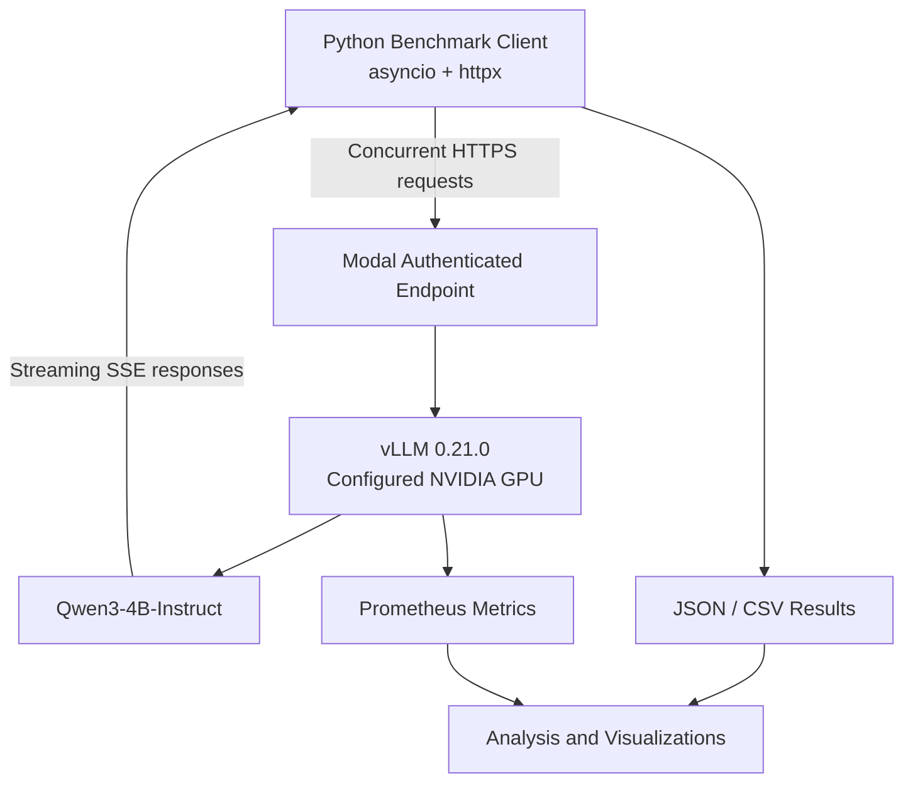
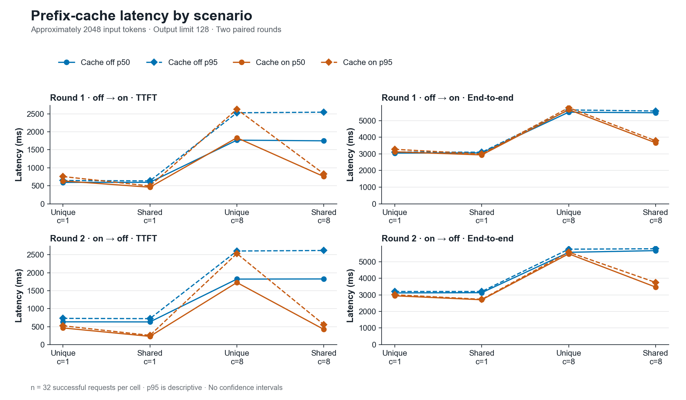
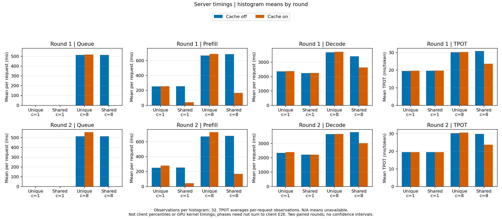
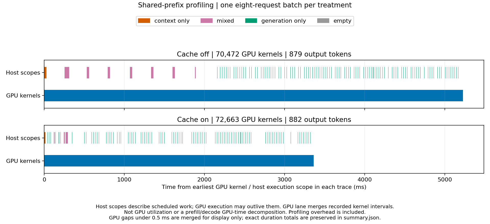

# LLM Inference Optimization Lab

**Investigating LLM inference performance with vLLM, Modal, and controlled GPU experiments.**

This project benchmarks Qwen3-4B-Instruct-2507 and investigates scheduling and prefix caching using request-level streaming measurements and server-side Prometheus metrics.

It contains two experiments: the L4 scheduling study and a prefix-cache benchmark configured for NVIDIA A10. A separate A10 GPU profiling pair provides diagnostic evidence.

## Contents

- [Project Overview](#project-overview)
    - [Tech Stack](#tech-stack)
    - [System Architecture](#system-architecture)
    - [Repository Structure](#repository-structure)
- [L4 Scheduling Study](#l4-scheduling-study)
    - [Findings](#findings)
    - [Configuration](#configuration)
    - [Methodology](#methodology)
    - [Results](#results)
- [Prefix-Cache (A10)](#prefix-cache-a10)
    - [Experimental Design](#experimental-design)
    - [Cache Results](#cache-results)
    - [Server Timing Analysis](#server-timing-analysis)
    - [GPU Profiling Case Study](#gpu-profiling-case-study)
- [Reproduction and Validation](#reproduction-and-validation)
    - [Saved Evidence](#saved-evidence)
    - [Validation](#validation)
    - [Reproducing the Experiments](#reproducing-the-experiments)
        - [Shared Setup](#shared-setup)
        - [L4 Scheduling Study Procedure](#l4-scheduling-study-procedure)
        - [Prefix-Cache Procedure (A10)](#prefix-cache-procedure-a10)
        - [GPU Profiling Procedure (A10)](#gpu-profiling-procedure-a10)
        - [Stop Any Live Deployment](#stop-any-live-deployment)
- [Limitations](#limitations)
- [Future Work](#future-work)
- [Conclusion](#conclusion)

## Project Overview

### Tech Stack

| Component | Technology |
|---|---|
| Model | Qwen3-4B-Instruct-2507 |
| Inference engine | vLLM 0.21.0 |
| GPU | NVIDIA A10 (prefix-cache benchmark and profiling); NVIDIA L4 (scheduling study) |
| Infrastructure | Modal |
| API | OpenAI-compatible HTTP API |
| Benchmarking | Python, asyncio, httpx |
| Streaming | Server-Sent Events (SSE) |
| Analysis | NumPy, Python statistics |
| Results | JSON, CSV, Prometheus metrics |

The project focuses on **inference serving and benchmarking**. It does not train, fine-tune, quantize, or modify the model weights.

### System Architecture



The inference server runs vLLM inside a Modal GPU container and exposes the OpenAI-compatible `/v1/chat/completions` endpoint.

The benchmark client sends asynchronous requests, processes streamed responses, and records request-level and batch-level performance measurements. Modal proxy authentication protects the endpoint.

### Repository Structure

```text
.
├── .github/           # CPU CI
├── bench/             # Benchmark and analysis tools
├── docs/              # Validation and profiling runbooks
├── figures/           # Scheduling figures and SVG generator
├── inference-runs/    # Cache and profiling evidence
├── metrics/           # Scheduling metric snapshots
├── results/           # Scheduling JSON/CSV results
├── tests/             # CPU tests
├── .gitattributes
├── .gitignore
├── modal_app.py        # Modal deployment
├── README.md
├── requirements.txt
└── server_config.py    # Server controls
```

<a id="historical-scheduling-l4"></a>

## L4 Scheduling Study

### Findings

- **Concurrency improved aggregate throughput but increased request latency.** For 256-token prompts, output throughput increased from 28.20 to 194.74 tokens/s as concurrency increased from 1 to 8.
- **Long prompts exhibited staggered time-to-first-token (TTFT).** At concurrency 8, requests experienced substantially different first-token delays despite having approximately equal input lengths.
- **Doubling the vLLM scheduling token budget did not improve performance.** Increasing `max_num_batched_tokens` from 2048 to 4096 increased median TTFT by 14.04% for short prompts and 1.51% for long prompts in the final comparison.
- **Server-side metrics provided additional diagnostic evidence.** A targeted eight-request experiment measured an average of 778 ms in queue time and 891 ms in prefill-phase time per request, with no observed prefix-cache hits or KV-cache preemptions.

The L4 scheduling study produced a **negative optimization result**: increasing the scheduling token budget did not improve the measured workloads. Its findings remain separate from the A10 prefix-cache benchmark and the A10 GPU profiling pair.

### Configuration

| Parameter | Value |
|---|---|
| GPU | L4 |
| Precision | BF16 |
| Maximum model length | 4096 tokens |
| GPU memory utilization target | 0.80 |
| Scheduling token budget | 2048 (control), 4096 (experiment) |
| Chunked prefill | Enabled |
| Prefix caching | Enabled |
| vLLM maximum sequences | 256 (resolved default) |
| Modal concurrent inputs | 8 |

Modal's concurrent-input limit and vLLM's maximum-sequence limit operate at different layers of the serving stack.

The cache study also uses the 2048-token scheduling budget; its treatment changes prefix caching on the configured A10 rather than the scheduling budget.

### Methodology

#### Workloads

Two deterministic synthetic summarization workloads were used:

| Workload | Approximate input tokens | Maximum output tokens |
|---|---:|---:|
| Short | 256 | 128 |
| Long | 2048 | 128 |

Prompts consist of seeded sequences of nature-related words. The generator provides repeatable input lengths and workload structure without depending on external datasets.

These prompts are intended for **controlled performance measurement**, not for evaluating model quality or representing realistic production traffic.

#### Metrics

The benchmark collects:

| Metric | Definition |
|---|---|
| **TTFT** | Client-observed time until the first nonempty generated-text streaming delta |
| **E2E latency** | Client-observed time from request start until response completion |
| **Output throughput** | Total generated output tokens divided by batch wall-clock duration |
| **Request throughput** | Successful requests divided by batch wall-clock duration |
| **Success rate** | Fraction of completed requests without recorded failures |

TTFT and E2E measurements include client, network, HTTP, and server overhead. They should not be interpreted as GPU kernel execution times.

#### Experimental Controls

The benchmark framework uses:

- Deterministic prompt-generation seeds.
- Fixed model, GPU type, input lengths, and generation limits.
- Concurrent request batches created using `asyncio.gather()`.
- Initial and workload-specific warmup requests, excluded from measured results.
- Per-request failure recording and success-aware aggregation.
- JSON and CSV checkpointing.
- Separate server deployments for each scheduling-budget configuration.

Cold-start latency was excluded from the steady-state performance comparisons.

### Results

#### 1. Baseline: Concurrency vs. Performance

The initial baseline tested concurrency levels of 1, 4, and 8, with five measured batches for each workload/concurrency combination.


| Workload | Concurrency | Median TTFT | Mean output throughput |
|---|---:|---:|---:|
| Short | 1 | 306.55 ms | 28.20 tok/s |
| Short | 4 | 437.36 ms | 105.34 tok/s |
| Short | 8 | 651.04 ms | 194.74 tok/s |
| Long | 1 | 561.40 ms | 25.62 tok/s |
| Long | 4 | 1406.14 ms | 78.42 tok/s |
| Long | 8 | 2099.93 ms | 120.04 tok/s |


Increasing concurrency substantially improved aggregate throughput, but each request experienced greater latency, particularly for longer prompts.

This established the primary **tradeoff between throughput and latency** investigated in subsequent experiments.

#### 2. Scheduling Optimization Hypothesis

vLLM's `max_num_batched_tokens` controls the shared token budget available within a scheduling iteration.

With chunked prefill enabled, long prompt-prefill operations can be divided across scheduling iterations and interleaved with decoding work.

**Hypothesis:** Increasing the scheduling budget from 2048 to 4096 tokens could allow more prefill work to execute per iteration, potentially reducing TTFT for concurrent long prompts.

The change could also affect decoding latency and batch efficiency, so improvement was not guaranteed.

Two configurations were evaluated:

- **Control:** `max_num_batched_tokens=2048`
- **Experiment A:** `max_num_batched_tokens=4096`

#### 3. A/B Experiment: 2048 vs. 4096

Following an initial five-trial exploratory comparison, both configurations were evaluated using 20 measured batches per workload at concurrency 8.

Each configuration completed 320 measured requests. Across both configurations, **all 640 requests succeeded**.

##### Short prompts (256 tokens)

| Metric | Budget 2048 | Budget 4096 | Change |
|---|---:|---:|---:|
| TTFT p50 | 587.37 ms | 669.82 ms | +14.04% |
| TTFT p95 | 653.89 ms | 701.11 ms | +7.22% |
| E2E p50 | 5113.10 ms | 5168.82 ms | +1.09% |
| Mean output throughput | 198.11 tok/s | 197.01 tok/s | −0.56% |

##### Long prompts (2048 tokens)

| Metric | Budget 2048 | Budget 4096 | Change |
|---|---:|---:|---:|
| TTFT p50 | 2256.97 ms | 2291.16 ms | +1.51% |
| TTFT p95 | 2972.13 ms | 3058.97 ms | +2.92% |
| E2E p50 | 8442.66 ms | 8534.67 ms | +1.09% |
| Mean output throughput | 120.13 tok/s | 118.86 tok/s | −1.06% |


**Result:** Raising the token budget to 4096 did not improve the targeted long-prompt workload. Median and tail TTFT were slightly worse, while output throughput decreased by approximately 1%.

The larger budget also produced notably worse short-prompt TTFT in the 20-trial comparison.

These differences describe the observed experiment runs; they are not claims of statistical significance or universal superiority of one configuration.

#### 4. Investigating the TTFT Staircase

An additional analysis examined first-token latency within each concurrent batch.

For each long-prompt trial, the eight TTFT measurements were sorted from fastest to slowest. Across repeated trials, requests frequently exhibited distinct groups of first-token arrival times.


The pattern was consistent with staggered scheduling and prefill execution, but client-observed TTFT alone could not establish which internal scheduler operations caused the gaps.

A follow-up diagnostic used vLLM's Prometheus metrics to investigate queueing, prefill, prefix-cache reuse, and preemption behavior.

##### Server-side diagnostic

A single measured batch of eight concurrent 2048-token prompts produced:

| Server-side measurement | Mean per request |
|---|---:|
| TTFT | 2142.88 ms |
| Queue time | 777.62 ms |
| Prefill-phase time | 891.12 ms |

Additional observations:

- **16384 prompt tokens** were newly processed across eight requests.
- **Zero prefix-cache hits** were recorded during the diagnostic batch.
- **Zero KV-cache preemptions** were recorded.
- A separate repeated-prompt diagnostic recorded 16 cached prompt tokens across two completed requests, providing evidence that prefix caching was functional.

These findings support scheduling queueing and prefill contention as plausible contributors to staggered TTFT.

However, the aggregate measurements do **not** reconstruct individual scheduler iterations or prove the precise causal contribution of chunked prefill.

The eight-request diagnostic is derived from [metrics-before-long.txt](metrics/metrics-before-long.txt) and [metrics-after-long.txt](metrics/metrics-after-long.txt). Subtract the before counter from the after counter, then divide each latency-sum delta by the completed-request count delta (8) and multiply by 1000 to obtain milliseconds. This gives 2142.88 ms TTFT, 777.62 ms queue time, and 891.12 ms prefill time. The prompt-token delta is 16384; cache-hit and preemption deltas are zero. The pair has matching metric creation timestamps.

## Prefix-Cache (A10)

### Experimental Design

**Question:** Does prefix caching reduce latency when requests reuse a document, and how does that behavior compare with unique-prefix requests?

Four fresh treatment sessions covered two paired rounds: cache-off → cache-on with seed 42, then cache-on → cache-off with seed 43. Each treatment measured 32 requests in each of four scenarios, totaling **512 measured requests**. Warmup and priming requests were excluded.

Inputs targeted 2048 tokens after chat templating, with a 128-token output limit and normal EOS behavior. The deployment used BF16, a 4096-token context limit, and a fixed scheduling token budget of 2048. Shared-document workloads targeted approximately 90% common input prefixes; these controlled fixtures do not represent measured production traffic.

### Cache Results

Changes below compare cache-on with cache-off within each round. Negative latency changes mean lower latency.

| Round | Prefix | Concurrency | Median TTFT change | Median E2E change |
|---|---|---:|---:|---:|
| 1 | Unique | 1 | +6.8% | +2.5% |
| 1 | Shared | 1 | −22.8% | −3.9% |
| 1 | Unique | 8 | +3.8% | +2.8% |
| 1 | Shared | 8 | −56.8% | −33.0% |
| 2 | Unique | 1 | −26.8% | −5.6% |
| 2 | Shared | 1 | −63.7% | −13.6% |
| 2 | Unique | 8 | −5.2% | −1.6% |
| 2 | Shared | 8 | −76.8% | −38.8% |

Shared-prefix cache-on windows recorded approximately **89.1% token cache-hit rates**. Newly computed prefill tokens fell from approximately 65,535 to 7,167 per measured scenario. Unique-prefix cache-on windows recorded zero hits and unchanged prefill-token totals. No measured request failures or KV-cache preemptions were recorded.



[Comparison JSON](inference-runs/cache-study-live-01/comparison/comparison.json) · [Comparison CSV](inference-runs/cache-study-live-01/comparison/comparison.csv) · [Raw experiment artifacts](inference-runs/cache-study-live-01/)

**Interpretation and limitations:** Shared-prefix latency improvements coincide with observed cache reuse and reduced prefill work. Their magnitude varies substantially between rounds. Unique-prefix latency also changes despite zero hits, showing that session variability contributes to the timing differences. These two paired rounds are exploratory; requests within a session are not independent replications. No pooled speedup or confidence interval is claimed. Measurements include client/network overhead, and throughput includes checkpoint overhead. GPU identity and server package versions remain declared deployment settings rather than independently captured runtime identities. Recorded client worktrees were dirty, so matching Git revisions alone cannot establish identical uncommitted code.

### Server Timing Analysis

The same saved measurement windows contain queue, prefill, decode, and time-per-output-token (TPOT) histograms. Every timing mean below uses 32 request observations, with warmup and priming excluded. Values show **cache-off → cache-on** within each round.

| Round | Shared-prefix concurrency | Mean queue (ms) | Mean prefill (ms) | Mean decode (ms) | Mean TPOT (ms/token) |
|---|---:|---:|---:|---:|---:|
| 1 | 1 | <0.1 → <0.1 | 254.8 → 39.6 | 2236.4 → 2260.1 | 19.59 → 19.69 |
| 2 | 1 | <0.1 → <0.1 | 254.8 → 43.8 | 2221.9 → 2219.4 | 19.59 → 19.56 |
| 1 | 8 | 515.3 → <0.1 | 684.5 → 166.2 | 3409.7 → 2642.6 | 30.87 → 23.58 |
| 2 | 8 | 512.4 → <0.1 | 679.6 → 170.1 | 3785.6 → 3022.8 | 29.90 → 23.80 |



At concurrency 1, shared-prefix prefill means fell by approximately 83–84%, while decode means and TPOT stayed nearly unchanged. Decode remained over two seconds per request, consistent with a smaller E2E improvement than TTFT improvement. At concurrency 8, cache-on shared-prefix windows also showed queue means falling from approximately 512–515 ms to below 0.1 ms, plus lower decode means and TPOT. These observations are consistent with reduced prefill work changing contention among requests; they do not isolate GPU execution or prove a particular scheduling mechanism.

Unique-prefix windows recorded no cache hits and no corresponding prefill reduction: server prefill means were approximately unchanged or higher with cache-on, even where client median TTFT improved. This reinforces the evidence of session variability. Server histogram means are distinct from client medians and do not provide an exact decomposition of those medians. TPOT averages per-request observations, and decode durations also depend on generated output length. These are server phase means; the separate diagnostic pair below adds GPU traces.

### GPU Profiling Case Study

A separate cache-off/cache-on pair profiled the same eight shared-prefix requests at concurrency 8, using fresh server processes. Both worker traces report **NVIDIA A10** in their device metadata. The downloaded traces were verified against SHA-256 receipts and reconciled with raw request counters and cache metrics.

| Diagnostic observation | Cache off | Cache on |
|---|---:|---:|
| Newly computed prefill / annotated context tokens | 16,384 | 1,792 |
| Host iterations containing context work | 9 | 4 |
| GPU kernel events | 70,472 | 72,663 |
| Summed GPU kernel duration | 5,188.9 ms | 3,328.7 ms |
| Union of GPU kernel intervals | 5,184.8 ms | 3,324.4 ms |
| First-to-last GPU kernel span | 5,224.8 ms | 3,363.2 ms |
| Generated output tokens | 879 | 882 |



Cache-on reused 89.1% of input tokens. Context work appeared in one context-only and three mixed context/generation host iterations, compared with one context-only and eight mixed iterations with cache-off. Their annotated context-token totals exactly match the measured new-prefill counters. These iteration counts include chunked prefill and are not request counts.

The kernel table shows a change in execution mix. For example, the large-tile `cutlass_80_tensorop_bf16_s16816gemm_relu_bf16_256x128_32x3_tn_align8` kernel fell from 864 calls / 1,410.4 ms to 72 calls / 62.1 ms. Meanwhile, the `ampere_bf16_s16816gemm_bf16_64x64_sliced1x2_ldg8_f2f_stages_64x6_tn` kernel increased from 9,000 calls / 1,311.3 ms to 9,432 calls / 1,373.6 ms. Lower total kernel duration alongside a higher overall kernel count shows why counting launches alone does not characterize GPU work. The observations are consistent with reduced prefill computation changing the kernel mix.

Host annotations describe CPU execution scopes; asynchronous GPU work can outlive them. The analysis keeps the two lanes separate and does not assign GPU phase durations by timestamp overlap. GPU gaps below 0.5 ms are merged for display only; exact duration totals remain in the summary. Neither the summed durations nor their interval union measures SM utilization. This is one instrumented batch per treatment, with slightly different output lengths and fixed off→on order; it is diagnostic evidence, not an additional benchmark speedup estimate. The original 512-request comparison is unchanged.

[Profiling summary](inference-runs/profiling/comparison/summary.json) · [Full kernel names and durations](inference-runs/profiling/comparison/kernels.csv) · [Execution annotations](inference-runs/profiling/comparison/annotations.csv) · [Reproduce the offline analysis](docs/profiling.md#offline-analysis)

## Reproduction and Validation

### Saved Evidence

The [cache-study artifacts](inference-runs/cache-study-live-01/) and [profiling artifacts](inference-runs/profiling/) retain workloads, request outcomes, startup evidence, raw snapshots, and generated analyses. The profiling directory also includes compressed traces and verification receipts.

The L4 scheduling study datasets, in run-filename order, are:

| File | Description |
|---|---|
| [results/20261019_014825.json](results/20261019_014825.json) | 5 batches per workload at concurrency 1, 4, and 8; 30 batches and 130 successful requests. Scheduling budget is not recorded in this older file. Sources figures 01 and 02. |
| [results/20261019_024946.json](results/20261019_024946.json) | 20 batches per workload at concurrency 8, recorded budget 2048; 40 batches and 320 successful requests. Sources figures 03 and 04. |
| [results/20261019_030158.json](results/20261019_030158.json) | 20 batches per workload at concurrency 8, recorded budget 4096; 40 batches and 320 successful requests. Sources figures 03 and 04. |

Each timestamped JSON has a corresponding `.csv` request-table export. All CSV rows match the JSON values for their exported fields. The baseline CSV omits the scheduling-budget column; the two A/B CSVs include it. JSON remains the analysis source because it preserves nested batches and full request records.

The retained diagnostic snapshots have the following roles:

| Files | Role and interpretation |
|---|---|
| [metrics/metrics-before-long.txt](metrics/metrics-before-long.txt), [metrics/metrics-after-long.txt](metrics/metrics-after-long.txt) | Paired cumulative counters supporting the eight-request diagnostic above. Keep both snapshots to preserve the subtraction baseline. |
| [metrics/metrics-repeated.txt](metrics/metrics-repeated.txt) | Two completed requests, 38 prompt tokens, and 16 cached prompt tokens. Supports the separate cache-functionality observation. The exact request payloads and replay command are not committed. |

The saved metrics reproduce the reported counter calculations, but the repository does not contain a script to replay those diagnostic requests and capture the snapshots. Keep these measurements distinct from the timestamped client benchmark datasets.

### Validation

For a complete offline check of the tooling and committed measurements, follow the [validation runbook](docs/validation.md). It regenerates comparisons in temporary directories without a GPU deployment.

From the repository root with local dependencies installed:

```bash
python -m unittest discover -s tests -v
```

These tests cover server configuration, JSON/CSV persistence, streaming-response validation, L4 scheduling study comparisons, document manifests, and cache-study execution against a fake server. They run locally without a Modal deployment or GPU. A tokenizer integration check uses the pinned tokenizer only when it is already cached locally.

The [CPU tests workflow](.github/workflows/tests.yml) runs on pushes and pull requests using Python 3.11. It first runs the suite offline with an isolated Hugging Face cache. It then downloads the pinned tokenizer files and runs the tokenizer integration check separately, also offline. That step sets `INFERENCE_LAB_REQUIRE_TOKENIZER=true`, so an unavailable tokenizer fails instead of skipping. Model weights, GPUs, and Modal credentials are not needed; dependency installation and the tokenizer download require network access. CI checks the tooling without rerunning the live performance experiments.

The pilot checker also validates saved request results and raw snapshots, rather than relying only on a completed status:

```bash
python -m bench.check_cache_pilots inference-runs/cache-study-live-01
```

### Reproducing the Experiments

Complete shared setup, then choose the L4 scheduling study, A10 prefix-cache, or A10 GPU profiling procedure. Each has its own runner and outputs; the numbered steps restart within each procedure.

#### Shared Setup

Use this setup for any live procedure below. Offline validation and analysis of saved results do not require a running GPU deployment.

##### Prerequisites

- Python 3.11 or a compatible local Python environment.
- A Modal account with GPU access and configured credentials.

The GPU-side environment is built separately through `modal_app.py`, which installs vLLM 0.21.0.

##### Install Local Dependencies

```bash
git clone --branch cache-study https://github.com/malcolmshi123/llm-inference-optimization-lab.git
cd llm-inference-optimization-lab

python -m venv .venv
source .venv/Scripts/activate

python -m pip install -r requirements.txt
python -m modal setup
```

The activation command above is intended for Git Bash on Windows. Other shells use their corresponding virtual-environment activation command.

##### Server Defaults

`server_config.py` pins the model and tokenizer revision and explicitly enables chunked prefill. Defaults use A10, BF16 precision, 4096-token context, 0.80 memory target, and 2048-token scheduling budget. Invalid treatment settings fail before deployment. The startup log prints the server command.

##### Endpoint and Authentication

Once your chosen procedure prints its deployed endpoint, set the client environment before sending requests:

```bash
export VLLM_BASE_URL="<your-modal-endpoint>"
export MODAL_PROXY_KEY="<your-proxy-key>"
export MODAL_PROXY_SECRET="<your-proxy-secret>"
```

`VLLM_BASE_URL` should be the endpoint root, without a trailing `/v1`.

Do not commit authentication credentials to version control.

<a id="historical-scheduling-procedure-l4"></a>

#### L4 Scheduling Study Procedure

This procedure tests the 2048-versus-4096 scheduling budget with `bench.async_client`. It does not run the prefix-cache study. The final two steps analyze the committed L4 scheduling study datasets offline.

##### 1. Select L4 and Deploy the Scheduling Configuration

Set `GPU_TYPE` to `"L4"` in `server_config.py` before deploying to match the L4 scheduling study's hardware. Leaving the A10 default produces a new A10 scheduling experiment. Keep profiling disabled for these benchmark runs.

Deploy the 2048-token control with prefix caching enabled:

```bash
INFERENCE_LAB_PREFIX_CACHING=true \
INFERENCE_LAB_MAX_NUM_BATCHED_TOKENS=2048 \
python -m modal deploy modal_app.py
```

The deployment prints its endpoint. Complete [Endpoint and Authentication](#endpoint-and-authentication) before the smoke test. Deployment variables configure the server; client arguments only record metadata.

##### 2. Smoke Test the Scheduling Endpoint

```bash
python -m bench.client
```

This sends one streaming request and reports client-observed latency.

##### 3. Run the Scheduling Benchmarks

For the 2048-token scheduling-budget configuration:

```bash
python -m bench.async_client \
  --concurrency 8 \
  --trials 20 \
  --max-num-batched-tokens 2048
```

For the 4096-token configuration, first redeploy with `INFERENCE_LAB_MAX_NUM_BATCHED_TOKENS=4096`, then run:

```bash
python -m bench.async_client \
  --concurrency 8 \
  --trials 20 \
  --max-num-batched-tokens 4096
```

**Important:** The benchmark client's `--max-num-batched-tokens` argument records experiment metadata. It does not change the running vLLM server's configuration.

Results are written to timestamped JSON and CSV files in `results/`.

##### 4. Compare Saved Scheduling Results

The command below reads the committed L4 results. To compare newly collected runs, substitute their timestamped JSON paths.

```bash
python -m bench.compare_batches \
  results/20261019_024946.json \
  results/20261019_030158.json
```

The comparison utility validates the datasets, computes latency percentiles and mean throughput, reports percentage differences, and analyzes within-batch TTFT gaps. Use `bench.compare_batches` for comparisons and `bench.batch_results` for JSON/CSV persistence.

Metric analysis uses the pinned [vLLM metric definitions](https://docs.vllm.ai/en/v0.21.0/usage/metrics/) and saved snapshots. Reproduce the existing eight-request diagnostic offline:

```bash
python -m bench.cache_metrics metrics/metrics-before-long.txt metrics/metrics-after-long.txt
```

This L4 scheduling study diagnostic reports 16,384 prefix queries, zero hits, 16,384 newly computed prefill tokens, and zero preemptions. Missing counters remain unavailable. Counter resets, changed process identities, and incompatible labels are rejected.

##### 5. Regenerate L4 Scheduling Study Figures

```bash
python figures/generate_figures.py
```

The generator uses only Python's standard library and the three primary benchmark JSON files listed in [Saved Evidence](#saved-evidence). It writes the four SVGs referenced in this README and does not require an active Modal deployment. The committed PNG files are convenience exports; this command does not regenerate them.

#### Prefix-Cache Procedure (A10)

The document/Q&A cache study has completed two paired rounds on a deployment configured for NVIDIA A10. See [Cache Results](#cache-results) for measured findings and limitations. The commands below reproduce the experiment; the L4 scheduling study results remain separate.

Use `GPU_TYPE = "A10"` in `server_config.py`; restore that setting if you selected L4 for scheduling. This procedure uses `bench.cache_study`, fresh treatment processes, and saved manifests. It does not use the scheduling benchmark's trial sequence.

##### 1. Prepare the Cache Workloads

Prepare two saved workloads, with 32 requests per scenario and different seeds between rounds:

```bash
python -m bench.cache_study prepare --seed 42 --count 32 --output workloads/cache-round-1.json
python -m bench.cache_study prepare --seed 43 --count 32 --output workloads/cache-round-2.json
```

Each manifest contains unique-prefix and approximately 90% shared-prefix scenarios at concurrency 1 and 8. Inputs target 2048 tokens within 5% after chat templating. Outputs have a fixed limit of 128 tokens with normal EOS behavior. Readable local fixtures form a controlled document workload; the distribution is not measured production traffic. Use `--count 1` for a preliminary replay or `--count 8` for a small batch check before the full study. Count applies to each of the four scenarios.

##### 2. Run Four Fresh Cache Treatments

Start a fresh server with caching disabled and scheduling budget 2048. Save its actual `Starting vLLM server with command:` line from the Modal container logs in `logs/cache-off.txt`. The runner requires that line as evidence of the fixed command; do not substitute a locally generated command. Then run:

```bash
python -m bench.cache_study run \
  --manifest workloads/cache-round-1.json \
  --expected-prefix-caching off \
  --server-log logs/cache-off.txt \
  --output-dir results/cache-study/round-1-off
```

The runner verifies the cache flag and memory target through `/metrics`, warms the engine with eight unrelated requests, primes each shared prefix, and captures snapshots around measured batches. Cache-off receives the same primers as cache-on. The startup log provides command evidence; GPU identity and software versions on the server remain declared deployment settings rather than independent runtime measurements.

Each measured window must also reconcile the `vllm:request_success_total` deltas, grouped by `finished_reason`, with the recorded successful requests. The runner and offline comparison reject missing counters, mismatched counts or finish reasons, and unexpected server-side completions such as aborts or errors. This checks the saved snapshots without changing historical result files; matching aggregate counts cannot prove request identity.

Run four fresh treatment sessions in order: round 1 off→on, then round 2 on→off. Replay the same manifest within each round. For each session after the first, pass `--previous-run` with the preceding session's `run.json` to reject a reused server process. Stop and redeploy between sessions; changing the expected flag does not change the server.

Each output directory contains `workload.json`, `run.json`, `requests.csv`, `server.log`, and raw `.prom` snapshots. Warmup and priming are stored separately from measured batches and CSV rows. Checkpoints retain completed batches and failures if the session stops. Do not resume a partially measured session as a full comparison; use a new directory and a fresh server.

##### 3. Compare the Cache Treatments

After completing all four fresh treatment sessions, compare them without redeploying the server:

```bash
python -m bench.compare_cache \
  --round-1-off results/cache-study/round-1-off \
  --round-1-on results/cache-study/round-1-on \
  --round-2-off results/cache-study/round-2-off \
  --round-2-on results/cache-study/round-2-on \
  --output-dir figures/cache-study \
  --require-cache-metrics
```

Use `--require-cache-metrics` for published cache-study results. It requires query, hit, and newly computed prefill counters in every measured window; zero values remain valid. Omit it for diagnostic analysis that permits unavailable telemetry.

The comparison validates identical workloads within each pair, distinct seeds between rounds, matching client versions and declared server controls, four distinct server process identities, and the off→on/on→off execution order. It recomputes counter deltas from raw snapshots and rejects partial sessions, request mismatches, and inconsistent preparation or measurement phases. Dirty client worktrees are flagged because a shared Git revision cannot prove identical uncommitted code.

The output contains `comparison.json`, `comparison.csv`, and three figures exported as PNG and SVG: `01_cache_latency`, `02_cache_prefill`, and `03_server_timings`. JSON preserves per-round cache-on percentage changes; CSV contains each treatment's latency p50/p95, completed-work throughput, actual token totals, failures, finish reasons, and metric changes. Throughput uses the full measured elapsed time. Latency percentiles and token totals use successful requests; failures remain in the attempted-request count. Existing output directories are not overwritten. The JSON `kind` remains `cache_comparison`, which identifies the data format independently of its filename.

Each JSON/CSV row also includes `server_{phase}_mean_ms` and `server_{phase}_observations` for `queue`, `prefill`, `decode`, and `time_per_output_token`. Means use histogram sum/count deltas from the saved measurement window, weighted by observation counts across engines. TPOT is the mean of per-request TPOT observations. These are server means, not client percentiles or GPU kernel timings; the phases need not sum to client E2E latency. Missing timing telemetry is `null` in JSON and blank in CSV. An available histogram with no observations has count zero and an unavailable mean. Existing saved runs need no changes.

Both rounds remain separate. Two paired rounds support an exploratory comparison; requests within one session are not independent replications. No confidence intervals or pooled speedup are reported. Missing telemetry remains unavailable and is marked `N/A` in diagnostic cache figures. Workloads with fewer than the planned 32 requests per scenario are identified as pilots. The reported results use saved live measurements; offline figure tests use synthetic data.

#### GPU Profiling Procedure (A10)

Use the A10 setting and the shared endpoint/authentication setup. This is a separate diagnostic capture with `bench.profile_capture`, not a scheduling or cache-performance benchmark. Follow the linked profiling runbook for the complete off/on procedure.

For a separate diagnostic profiling deployment, set `INFERENCE_LAB_PROFILE_SESSION` to a unique session label such as `shared-c8-off-01`. Labels accept 1–64 ASCII letters, digits, underscores, or hyphens and must start with a letter or digit. An unset or blank value leaves profiling disabled.

This adds vLLM's `--profiler-config` for PyTorch Profiler and mounts the persistent Modal Volume `inference-lab-profiles` at `/profiles`. Traces target `/profiles/<session-label>/`; the startup log prints that directory. Stack, shape, memory, and FLOP recording are disabled, and trace compression is enabled. Capture still requires explicit `/start_profile` and `/stop_profile` calls; configuring the profiler does not start a capture. See the [vLLM 0.21 profiling documentation](https://docs.vllm.ai/en/v0.21.0/contributing/profiling/).

Wait for `/stop_profile` to finish flushing and for the trace files to appear on the Volume before stopping the deployment. Modal commits Volume changes in the background and at container shutdown. Download completed traces with `python -m modal volume get inference-lab-profiles <session-label> <local-directory> --env main`. See [Modal Volume persistence](https://modal.com/docs/guide/volumes#background-commits) and [Volume CLI commands](https://modal.com/docs/reference/cli/volume).

Use a fresh label for each treatment and retry so old and new traces remain distinguishable. Profiling captures belong outside the measured cache-study sessions: profiling adds overhead, and the cache-study runner rejects startup commands containing profiling flags. Before returning to normal benchmarks, unset `INFERENCE_LAB_PROFILE_SESSION` and redeploy. The profiling pair is separate from the 512-request benchmark comparison.

`bench.profile_capture` captures one treatment against an already ready profiling deployment. It reuses the first eight `shared-c8` requests from a saved cache-study manifest; manifests with fewer than eight requests per scenario are rejected. After eight unrelated warmup requests and one prefix-primer request, it starts profiling, sends one concurrent eight-request batch, and stops profiling. Preparation is outside the trace.

```bash
python -m bench.profile_capture \
  --manifest inference-runs/cache-study-live-01/workloads/round-1.json \
  --expected-prefix-caching off \
  --profile-session shared-c8-off-01 \
  --server-log <profiling-server-startup-log> \
  --output-dir inference-runs/profiling/shared-c8-off-01
```

The deployment's prefix-caching setting and profile session must match these arguments. Capture-off and capture-on should use fresh servers, distinct profile labels, and the same manifest. The driver validates the startup command, observed cache configuration, stable process identity, token counts, and completed-request counter deltas. Existing local output directories are not overwritten. It attempts `/stop_profile` after a start attempt even if the start response times out, a request fails, or the capture is interrupted; cleanup errors are recorded separately from the original failure.

Each output contains `capture.json`, the original manifest as `workload.json`, `server.log`, and raw metric snapshots. `capture.json` records preparation and captured request results, timestamps, profiler start/stop outcomes, and the expected remote trace directory. Its `kind` is `profile_capture`, separate from benchmark results. A `completed` capture means requests and profiler shutdown validated; it does not verify that trace files persisted or contain GPU events. `trace_files_verified` remains false in the capture record; a separate trace receipt records the download and GPU-event checks. The driver neither deploys nor stops Modal apps nor downloads traces.

Follow the [profiling runbook](docs/profiling.md) for the two manual deployments, readiness checks, bounded trace downloads, GPU-event checks, and automatic app shutdown. The runbook uses Git Bash and the existing saved workload; no new benchmark study is required.

#### Stop Any Live Deployment

Stop the app after completing your chosen live procedure. The profiling runbook and cache helper include automatic shutdown; the manual command is:

```bash
python -m modal app stop llm-inference-optimization-lab
```

Stopping the application terminates its active GPU containers while preserving separately managed persistent volumes.

## Limitations

The project has several constraints:

- **Test coverage:** One model, two GPUs, and a narrow set of settings and synthetic workloads do not represent production traffic.
- **Experiment reliability:** Few repeats, some fixed-order tests, uncommitted code, and declared cache-study hardware/software details limit confidence and reproducibility.
- **Timing overhead:** Client latency includes network overhead; cache throughput includes checkpoint time.
- **Diagnostic coverage:** GPU traces cover one shared-prefix pair and include profiling overhead. Server averages and CPU annotations do not show GPU phase timings or utilization.
- **Capacity and cost:** Sustainable capacity, requests meeting latency targets, and startup/idle costs were not measured.
- **Model quality:** Response quality and correctness were not evaluated.

## Future Work

Potential extensions:

- **Test coverage:** Compare more models, GPUs, server settings, prefix-sharing patterns, and mixed-length/bursty workloads.
- **Experiment reliability:** Repeat fresh comparisons in different orders with clean committed code and recorded GPU/software details; report variation across runs.
- **Timing overhead:** Measure checkpoint time separately and distinguish client/network overhead from server execution.
- **Diagnostic coverage:** Profile unique-prefix and long-output requests; investigate scheduling, KV-cache pressure, and GPU utilization.
- **Capacity and cost:** Measure request rates meeting latency targets, tokens per GPU-hour, and serving cost including startup and idle time.
- **Model quality:** Check answer quality when changing models, precision, or generation settings.

## Conclusion

The L4 scheduling study rejected a larger token budget for its measured workloads. The cache study observed shared-prefix reuse, reduced prefill work, and lower shared-prefix latency, alongside substantial timing variation across sessions. Both experiments use saved request results and server telemetry to distinguish implemented features from measured behavior.
