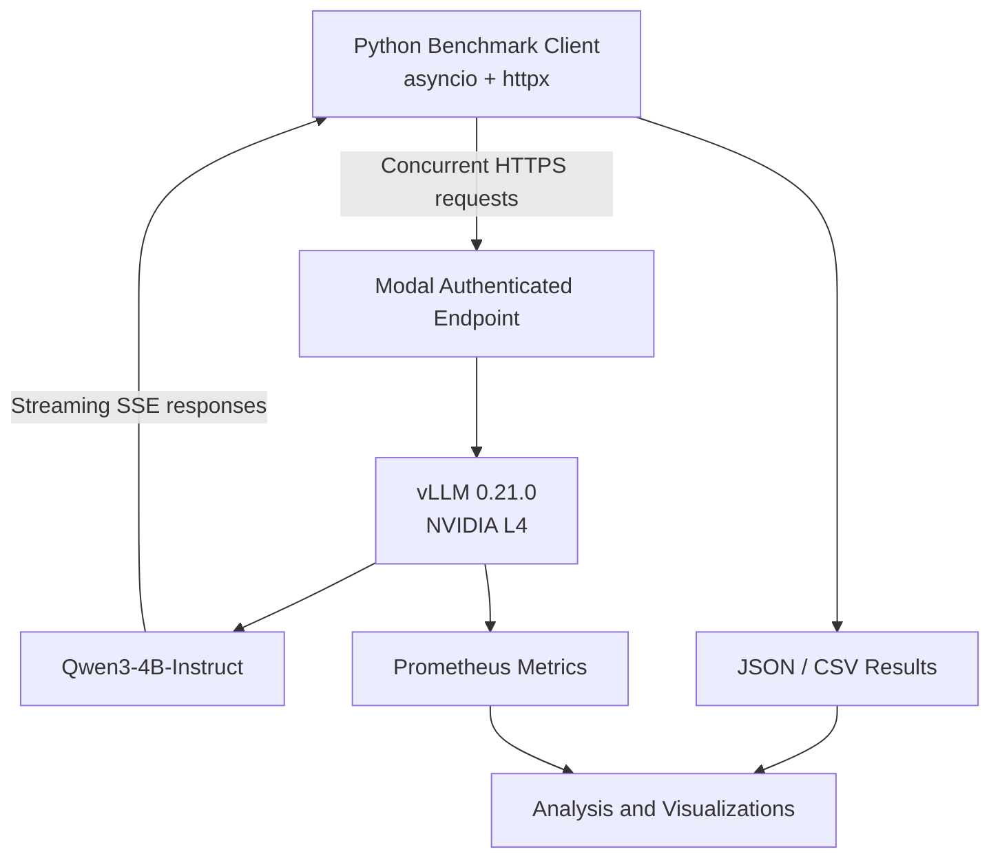
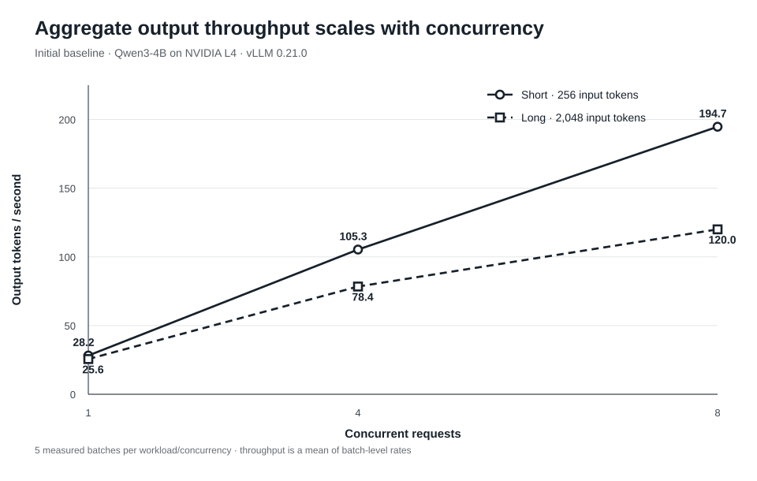
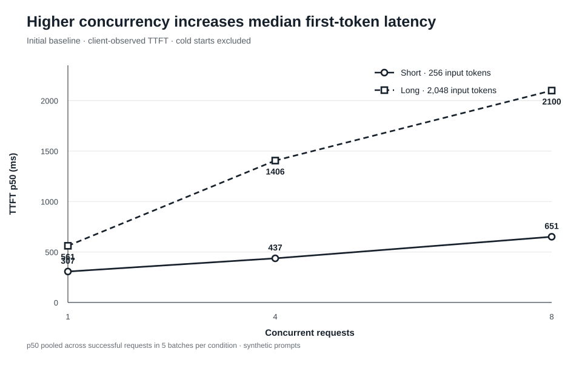
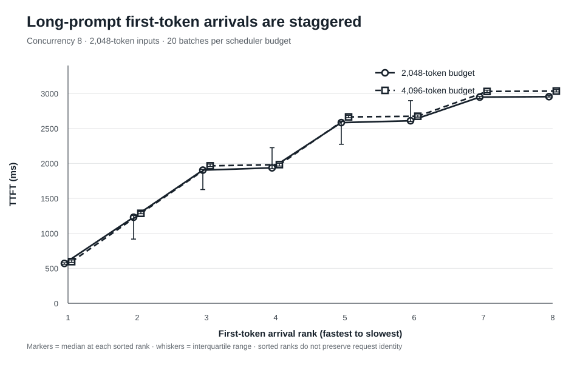

# LLM Inference Optimization Lab

**Benchmarking and investigating LLM inference performance using vLLM, NVIDIA L4, and Modal.**

This project deploys an open-weight language model on a serverless GPU, implements an asynchronous benchmarking framework, and evaluates the effects of vLLM scheduling configurations on inference latency and throughput.

The goal is to understand how **concurrency, prompt length, and scheduling decisions** affect model-serving performance—and to use measured evidence rather than assumptions when evaluating optimizations.

## Key Findings

- **Concurrency improved aggregate throughput but increased request latency.** For 256-token prompts, output throughput increased from 28.20 to 194.74 tokens/s as concurrency increased from 1 to 8.
- **Long prompts exhibited staggered time-to-first-token (TTFT).** At concurrency 8, requests experienced substantially different first-token delays despite having approximately equal input lengths.
- **Doubling the vLLM scheduling token budget did not improve performance.** Increasing `max_num_batched_tokens` from 2,048 to 4,096 increased median TTFT by 14.04% for short prompts and 1.51% for long prompts in the final comparison.
- **Server-side metrics provided additional diagnostic evidence.** A targeted eight-request experiment measured an average of 778 ms in queue time and 891 ms in prefill-phase time per request, with no observed prefix-cache hits or KV-cache preemptions.

The outcome is a **negative optimization result**: a plausible scheduling change was tested and rejected based on workload-specific measurements. The project does not claim an inference speedup.

## Tech Stack

| Component | Technology |
|---|---|
| Model | Qwen3-4B-Instruct-2507 |
| Inference engine | vLLM 0.21.0 |
| GPU | NVIDIA L4 |
| Infrastructure | Modal |
| API | OpenAI-compatible HTTP API |
| Benchmarking | Python, asyncio, httpx |
| Streaming | Server-Sent Events (SSE) |
| Analysis | NumPy, Python statistics |
| Results | JSON, CSV, Prometheus metrics |

The project focuses on **inference serving and benchmarking**. It does not train, fine-tune, quantize, or modify the model weights.

## System Architecture



The inference server runs vLLM inside a Modal GPU container and exposes the OpenAI-compatible `/v1/chat/completions` endpoint.

The benchmark client sends asynchronous requests, processes streamed responses, and records request-level and batch-level performance measurements. Modal proxy authentication protects the endpoint.

### Inference Configuration

| Parameter | Value |
|---|---|
| GPU | L4 |
| Precision | BF16 |
| Maximum model length | 4,096 tokens |
| GPU memory utilization target | 0.80 |
| Scheduling token budget | 2,048 (control), 4,096 (experiment) |
| Chunked prefill | Enabled |
| Prefix caching | Enabled |
| vLLM maximum sequences | 256 (resolved default) |
| Modal concurrent inputs | 8 |

Modal's concurrent-input limit and vLLM's maximum-sequence limit operate at different layers of the serving stack.

The final server configuration retains the 2,048-token scheduling budget, the better-performing of the two tested settings.

## Benchmark Methodology

### Workloads

Two deterministic synthetic summarization workloads were used:

| Workload | Approximate input tokens | Maximum output tokens |
|---|---:|---:|
| Short | 256 | 128 |
| Long | 2,048 | 128 |

Prompts consist of seeded sequences of nature-related words. The generator provides repeatable input lengths and workload structure without depending on external datasets.

These prompts are intended for **controlled performance measurement**, not for evaluating model quality or representing realistic production traffic.

### Metrics

The benchmark collects:

| Metric | Definition |
|---|---|
| **TTFT** | Client-observed time until the first nonempty generated-text streaming delta |
| **E2E latency** | Client-observed time from request start until response completion |
| **Output throughput** | Total generated output tokens divided by batch wall-clock duration |
| **Request throughput** | Successful requests divided by batch wall-clock duration |
| **Success rate** | Fraction of completed requests without recorded failures |

TTFT and E2E measurements include client, network, HTTP, and server overhead. They should not be interpreted as GPU kernel execution times.

### Experimental Controls

The benchmark framework uses:

- Deterministic prompt-generation seeds.
- Fixed model, GPU type, input lengths, and generation limits.
- Concurrent request batches created using `asyncio.gather()`.
- Initial and workload-specific warmup requests, excluded from measured results.
- Per-request failure recording and success-aware aggregation.
- JSON and CSV checkpointing.
- Separate server deployments for each scheduling-budget configuration.

Cold-start latency was excluded from the steady-state performance comparisons.

## Results

### 1. Baseline: Concurrency vs. Performance

The initial baseline tested concurrency levels of 1, 4, and 8, with five measured batches for each workload/concurrency combination.



| Workload | Concurrency | Median TTFT | Mean output throughput |
|---|---:|---:|---:|
| Short | 1 | 306.55 ms | 28.20 tok/s |
| Short | 4 | 437.36 ms | 105.34 tok/s |
| Short | 8 | 651.04 ms | 194.74 tok/s |
| Long | 1 | 561.40 ms | 25.62 tok/s |
| Long | 4 | 1,406.14 ms | 78.42 tok/s |
| Long | 8 | 2,099.93 ms | 120.04 tok/s |



Increasing concurrency substantially improved aggregate throughput, but each request experienced greater latency—particularly for longer prompts.

This established the primary **throughput–latency tradeoff** investigated in subsequent experiments.

### 2. Scheduling Optimization Hypothesis

vLLM's `max_num_batched_tokens` controls the shared token budget available within a scheduling iteration.

With chunked prefill enabled, long prompt-prefill operations can be divided across scheduling iterations and interleaved with decoding work.

**Hypothesis:** Increasing the scheduling budget from 2,048 to 4,096 tokens could allow more prefill work to execute per iteration, potentially reducing TTFT for concurrent long prompts.

The change could also affect decoding latency and batch efficiency, so improvement was not guaranteed.

Two configurations were evaluated:

- **Control:** `max_num_batched_tokens=2048`
- **Experiment A:** `max_num_batched_tokens=4096`

### 3. A/B Experiment: 2,048 vs. 4,096

Following an initial five-trial exploratory comparison, both configurations were evaluated using 20 measured batches per workload at concurrency 8.

Each configuration completed 320 measured requests. Across both configurations, **all 640 requests succeeded**.

#### Short prompts — 256 tokens

| Metric | Budget 2048 | Budget 4096 | Change |
|---|---:|---:|---:|
| TTFT p50 | 587.37 ms | 669.82 ms | +14.04% |
| TTFT p95 | 653.89 ms | 701.11 ms | +7.22% |
| E2E p50 | 5,113.10 ms | 5,168.82 ms | +1.09% |
| Mean output throughput | 198.11 tok/s | 197.01 tok/s | −0.56% |

#### Long prompts — 2,048 tokens

| Metric | Budget 2048 | Budget 4096 | Change |
|---|---:|---:|---:|
| TTFT p50 | 2,256.97 ms | 2,291.16 ms | +1.51% |
| TTFT p95 | 2,972.13 ms | 3,058.97 ms | +2.92% |
| E2E p50 | 8,442.66 ms | 8,534.67 ms | +1.09% |
| Mean output throughput | 120.13 tok/s | 118.86 tok/s | −1.06% |


**Result:** Raising the token budget to 4,096 did not improve the targeted long-prompt workload. Median and tail TTFT were slightly worse, while output throughput decreased by approximately 1%.

The larger budget also produced notably worse short-prompt TTFT in the 20-trial comparison.

These differences describe the observed experiment runs; they are not claims of statistical significance or universal superiority of one configuration.

### 4. Investigating the TTFT Staircase

An additional analysis examined first-token latency within each concurrent batch.

For each long-prompt trial, the eight TTFT measurements were sorted from fastest to slowest. Across repeated trials, requests frequently exhibited distinct groups of first-token arrival times.



The pattern was consistent with staggered scheduling and prefill execution, but client-observed TTFT alone could not establish which internal scheduler operations caused the gaps.

A follow-up diagnostic used vLLM's Prometheus metrics to investigate queueing, prefill, prefix-cache reuse, and preemption behavior.

#### Server-side diagnostic

A single measured batch of eight concurrent 2,048-token prompts produced:

| Server-side measurement | Mean per request |
|---|---:|
| TTFT | 2,142.88 ms |
| Queue time | 777.62 ms |
| Prefill-phase time | 891.12 ms |

Additional observations:

- **16,384 prompt tokens** were newly processed across eight requests.
- **Zero prefix-cache hits** were recorded during the diagnostic batch.
- **Zero KV-cache preemptions** were recorded.
- A separate repeated-prompt diagnostic recorded 16 cached prompt tokens across two completed requests, providing evidence that prefix caching was functional.

These findings support scheduling queueing and prefill contention as plausible contributors to staggered TTFT.

However, the aggregate measurements do **not** reconstruct individual scheduler iterations or prove the precise causal contribution of chunked prefill.

The eight-request diagnostic is derived from [metrics-before-long.txt](metrics/metrics-before-long.txt) and [metrics-after-long.txt](metrics/metrics-after-long.txt). Subtract the before counter from the after counter, then divide each latency-sum delta by the completed-request count delta (8) and multiply by 1000 to obtain milliseconds. This gives 2142.88 ms TTFT, 777.62 ms queue time, and 891.12 ms prefill time. The prompt-token delta is 16384; cache-hit and preemption deltas are zero. The pair has matching metric creation timestamps.

## Reproducing the Experiments

### Prerequisites

- Python 3.11 or a compatible local Python environment.
- A Modal account with GPU access and configured credentials.
- A running Modal deployment for live inference benchmarks.

The GPU-side environment is built separately through `modal_app.py`, which installs vLLM 0.21.0.

### 1. Install Local Dependencies

```bash
git clone https://github.com/malcolmshi123/llm-inference-optimization-lab.git
cd llm-inference-optimization-lab

python -m venv .venv
source .venv/Scripts/activate

python -m pip install -r requirements.txt
python -m modal setup
```

The activation command above is intended for Git Bash on Windows. Other shells use their corresponding virtual-environment activation command.

### 2. Deploy the Inference Server

Set the desired server-side `--max-num-batched-tokens` value in `modal_app.py`, then deploy:

```bash
python -m modal deploy modal_app.py
```

Modal prints the deployed web endpoint.

Set the endpoint and proxy-authentication credentials in the client environment:

```bash
export VLLM_BASE_URL="<your-modal-endpoint>"
export MODAL_PROXY_KEY="<your-proxy-key>"
export MODAL_PROXY_SECRET="<your-proxy-secret>"
```

`VLLM_BASE_URL` should be the endpoint root, without a trailing `/v1`.

Do not commit authentication credentials to version control.

### 3. Smoke Test

```bash
python -m bench.client
```

This sends one streaming request and reports client-observed latency.

### 4. Run the Benchmark

For the 2,048-token scheduling-budget configuration:

```bash
python -m bench.async_client \
  --concurrency 8 \
  --trials 20 \
  --max-num-batched-tokens 2048
```

For the 4,096-token configuration, first update and redeploy the server with that budget, then run:

```bash
python -m bench.async_client \
  --concurrency 8 \
  --trials 20 \
  --max-num-batched-tokens 4096
```

**Important:** The benchmark client's `--max-num-batched-tokens` argument records experiment metadata. It does not change the running vLLM server's configuration.

Results are written to timestamped JSON and CSV files in `results/`.

### 5. Compare Experiment Results

```bash
python -m bench.compare \
  results/20261019_024946.json \
  results/20261019_030158.json
```

The comparison utility validates the datasets, computes latency percentiles and mean throughput, reports percentage differences, and analyzes within-batch TTFT gaps.

### 6. Regenerate Figures

```bash
python figures/generate_figures.py
```

The generator uses only Python's standard library and the three primary benchmark JSON files listed below. It writes the four SVGs referenced in this README and does not require an active Modal deployment. The committed PNG files are convenience exports; this command does not regenerate them.

### 7. Stop the Deployment

```bash
python -m modal app stop llm-inference-optimization-lab
```

Stopping the application terminates its active GPU containers while preserving separately managed persistent volumes.

### Run tests

From the repository root with local dependencies installed:

```bash
python -m bench.test_results
python -m unittest bench.test_async_client -v
```

These tests cover JSON/CSV persistence and streaming-response validation. They run locally without a Modal deployment or GPU.

## Repository Structure

```text
.
├── modal_app.py
├── bench/
│   ├── client.py
│   ├── async_client.py
│   ├── test_async_client.py
│   ├── workloads.py
│   ├── results.py
│   ├── test_results.py
│   └── compare.py
├── results/
│   ├── 20261019_014825.json
│   ├── 20261019_024946.json
│   └── 20261019_030158.json
├── metrics/
│   └── ...
├── figures/
│   ├── generate_figures.py
│   └── ...
└── examples/
    └── ...
```

The benchmark datasets, in run-filename order, are:

| File | Description |
|---|---|
| [results/20261019_014825.json](results/20261019_014825.json) | Primary baseline: 5 batches per workload at concurrency 1, 4, and 8; 30 batches and 130 successful requests. Scheduling budget is not recorded in this older file. Sources figures 01 and 02. |
| [results/20261019_024946.json](results/20261019_024946.json) | Primary control: 20 batches per workload at concurrency 8, recorded budget 2048; 40 batches and 320 successful requests. Sources figures 03 and 04. |
| [results/20261019_030158.json](results/20261019_030158.json) | Primary candidate: 20 batches per workload at concurrency 8, recorded budget 4096; 40 batches and 320 successful requests. Sources figures 03 and 04. |

Each timestamped JSON has a corresponding `.csv` request-table export. All CSV rows match the JSON values for their exported fields. The baseline CSV omits the scheduling-budget column; the two A/B CSVs include it. JSON remains the analysis source because it preserves nested batches and full request records.

The retained diagnostic snapshots have the following roles:

| Files | Role and interpretation |
|---|---|
| [metrics/metrics-before-long.txt](metrics/metrics-before-long.txt), [metrics/metrics-after-long.txt](metrics/metrics-after-long.txt) | Paired cumulative counters supporting the eight-request diagnostic above. Keep both snapshots to preserve the subtraction baseline. |
| [metrics/metrics-repeated.txt](metrics/metrics-repeated.txt) | Two completed requests, 38 prompt tokens, and 16 cached prompt tokens. Supports the separate cache-functionality observation. The exact request payloads and replay command are not committed. |

The saved metrics reproduce the reported counter calculations, but the repository does not contain a script to replay those diagnostic requests and capture the snapshots. Keep these measurements distinct from the timestamped client benchmark datasets.

## Limitations

The experiments have several important constraints:

- **Single hardware and model configuration:** Results were obtained with Qwen3-4B on an NVIDIA L4.
- **Synthetic workload:** Fixed-length random-word prompts do not represent realistic production requests.
- **Fixed A/B experiment order:** The 2,048-token configuration was tested before 4,096, leaving potential run-order and deployment-state confounders.
- **Limited configuration search:** Only one alternative scheduling budget was formally compared.
- **Client-observed latency:** Network and HTTP effects were not isolated from model execution in the primary benchmark.
- **Limited server-side diagnosis:** Prometheus measurements covered a targeted diagnostic batch, not the entire A/B experiment.
- **No confidence intervals or hypothesis tests:** The reported differences should not be interpreted as statistically established causal improvements.
- **No model-quality evaluation:** The experiment measured serving performance rather than response correctness.

## Future Work

Potential extensions include:

- Repeat the A/B experiment in reverse or randomized configuration order.
- Evaluate more scheduling-budget settings with independent deployments.
- Collect per-request scheduler traces and GPU profiling measurements.
- Introduce realistic mixed-length request distributions and bursty traffic.
- Quantify uncertainty across independent benchmark sessions.
- Investigate decode/prefill interference, KV-cache management, and GPU utilization.

## Conclusion

This project demonstrates an end-to-end inference performance engineering workflow: deploying an open-weight model, implementing a concurrent streaming benchmark, establishing a performance baseline, testing a scheduling hypothesis, and investigating unexpected latency behavior using server-side telemetry.

The tested increase in scheduling token budget did not produce the anticipated improvement. The result reinforced an important systems-engineering principle:

**Inference optimization is workload-dependent, and performance changes should be accepted or rejected based on reliable measurements—not configuration intuition alone.**
