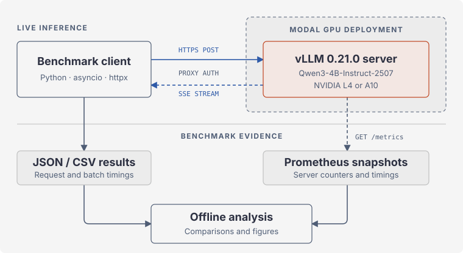
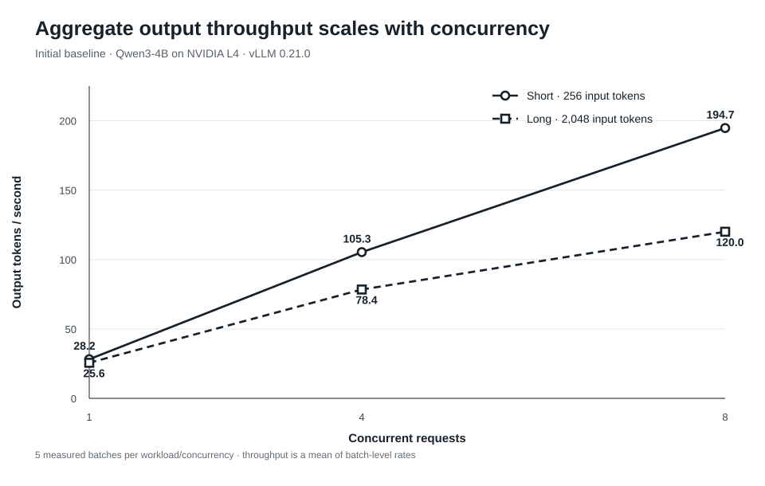
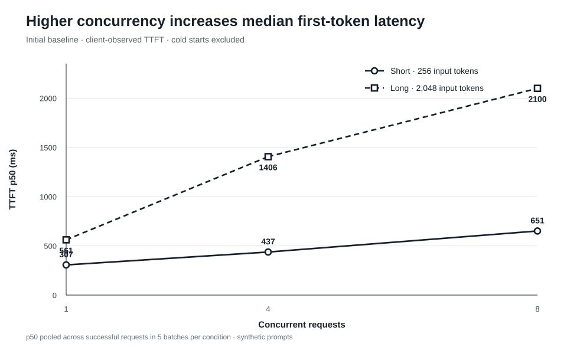
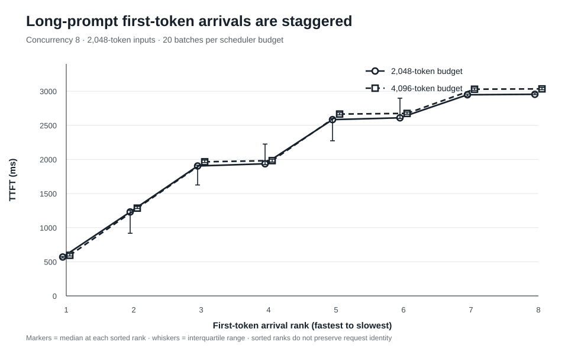
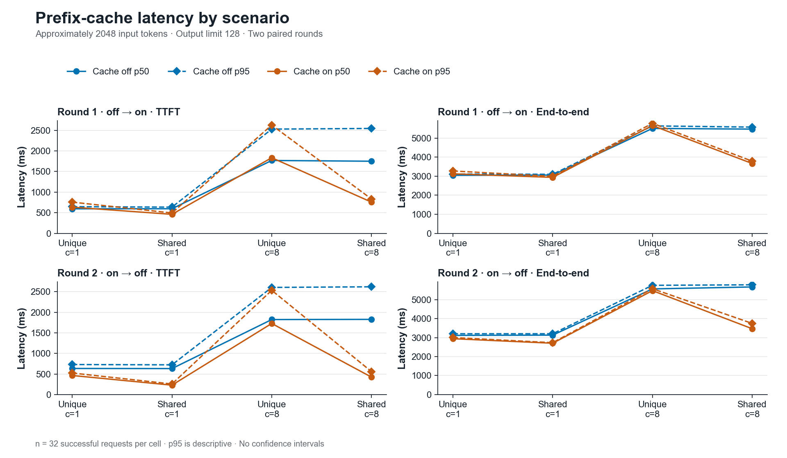
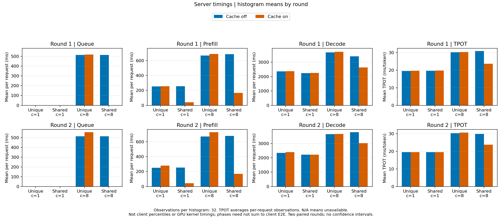
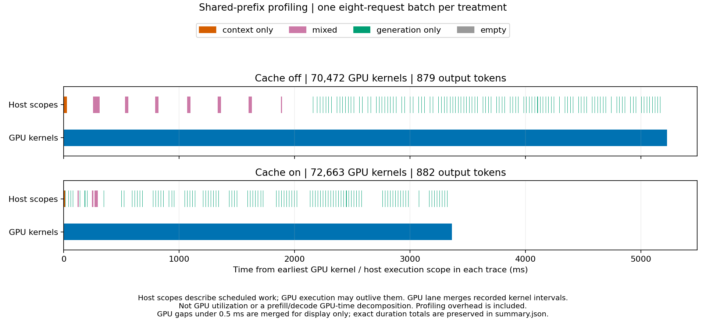

# LLM Inference Optimization Lab

**Benchmarking vLLM scheduling and prefix caching on Modal GPUs.**

This repository runs Qwen3-4B-Instruct-2507 with vLLM and measures inference latency and throughput under different serving configurations. A Python client records streaming responses; Prometheus counters and GPU traces help explain what happened inside the server.

There are two benchmark studies: a scheduling-budget comparison on NVIDIA L4 and a prefix-cache comparison configured for NVIDIA A10. A separate A10 profiling capture examines GPU execution during shared-prefix requests. The three sets of evidence are kept distinct.

## Contents

- [Project Overview](#project-overview)
    - [Tech Stack](#tech-stack)
    - [System Architecture](#system-architecture)
    - [Repository Structure](#repository-structure)
- [L4 Scheduling Study](#l4-scheduling-study)
    - [Findings](#findings)
    - [Configuration](#configuration)
    - [Methodology](#methodology)
    - [Results](#results)
- [Prefix-Cache (A10)](#prefix-cache-a10)
    - [Experimental Design](#experimental-design)
    - [Cache Results](#cache-results)
    - [Server Timing Analysis](#server-timing-analysis)
    - [GPU Profiling Case Study](#gpu-profiling-case-study)
- [Reproduction and Validation](#reproduction-and-validation)
    - [Saved Evidence](#saved-evidence)
    - [Validation](#validation)
    - [Reproducing the Experiments](#reproducing-the-experiments)
        - [Shared Setup](#shared-setup)
        - [L4 Scheduling Study Procedure](#l4-scheduling-study-procedure)
        - [Prefix-Cache Procedure (A10)](#prefix-cache-procedure-a10)
        - [GPU Profiling Procedure (A10)](#gpu-profiling-procedure-a10)
        - [Stop Any Live Deployment](#stop-any-live-deployment)
- [Limitations](#limitations)
- [Future Work](#future-work)
- [Conclusion](#conclusion)

## Project Overview

### Tech Stack

| Component | Technology |
|---|---|
| Model | Qwen3-4B-Instruct-2507 |
| Inference engine | vLLM 0.21.0 |
| GPU | NVIDIA A10 (prefix-cache benchmark and profiling); NVIDIA L4 (scheduling study) |
| Infrastructure | Modal |
| API | OpenAI-compatible HTTP API |
| Benchmarking | Python, asyncio, httpx |
| Streaming | Server-Sent Events (SSE) |
| Analysis | NumPy, Python statistics |
| Results | JSON, CSV, Prometheus metrics |

The work concerns model serving and measurement. It does not include training, fine-tuning, quantization, or changes to model weights.

### System Architecture



Modal runs the vLLM server on a configured GPU and exposes an OpenAI-compatible `/v1/chat/completions` endpoint.

The Python client issues concurrent requests, reads streamed responses, and saves timing and throughput measurements for individual requests and batches. Access to the endpoint requires Modal proxy authentication.

### Repository Structure

```text
.
├── .github/           # CPU CI
├── bench/             # Benchmark and analysis tools
├── docs/              # Validation and profiling runbooks
├── figures/           # Scheduling figures and SVG generator
├── inference-runs/    # Cache and profiling evidence
├── metrics/           # Scheduling metric snapshots
├── results/           # Scheduling JSON/CSV results
├── tests/             # CPU tests
├── .gitattributes
├── .gitignore
├── modal_app.py        # Modal deployment
├── README.md
├── requirements.txt
└── server_config.py    # Server controls
```

<a id="historical-scheduling-l4"></a>

## L4 Scheduling Study

### Findings

- For 256-token prompts, output throughput rose from 28.20 to 194.74 tokens/s between concurrency 1 and 8. Individual requests became slower as concurrency increased.
- Eight concurrent 2048-token prompts often received their first tokens at different times, even though their input lengths were similar.
- Raising `max_num_batched_tokens` from 2048 to 4096 increased median TTFT by 14.04% for short prompts and 1.51% for long prompts in the 20-trial comparison.
- In a separate eight-request diagnostic, the server recorded an average of 778 ms in queue time and 891 ms in prefill-phase time per request, with no prefix-cache hits or KV-cache preemptions.

The larger scheduling budget did not help either measured L4 workload. The A10 cache benchmark and profiling capture test different behavior and should not be treated as additional runs of the scheduling experiment.

### Configuration

| Parameter | Value |
|---|---|
| GPU | L4 |
| Precision | BF16 |
| Maximum model length | 4096 tokens |
| GPU memory utilization target | 0.80 |
| Scheduling token budget | 2048 (control), 4096 (experiment) |
| Chunked prefill | Enabled |
| Prefix caching | Enabled |
| vLLM maximum sequences | 256 (resolved default) |
| Modal concurrent inputs | 8 |

Modal's limit on concurrent inputs governs requests to the deployed function. vLLM's maximum-sequence setting is a separate limit inside the inference engine.

The A10 cache experiment also uses a 2048-token scheduling budget. It changes prefix caching instead of the scheduling budget.

### Methodology

#### Workloads

The L4 benchmark uses two deterministic synthetic workloads:

| Workload | Approximate input tokens | Maximum output tokens |
|---|---:|---:|
| Short | 256 | 128 |
| Long | 2048 | 128 |

The prompt generator uses seeded sequences of nature-related words to produce repeatable input lengths without an external dataset.

The text is deliberately artificial. It helps control prompt length, but says nothing about answer quality or performance on production traffic.

#### Metrics

The benchmark collects:

| Metric | Definition |
|---|---|
| **TTFT** | Client-observed time until the first nonempty generated-text streaming delta |
| **E2E latency** | Client-observed time from request start until response completion |
| **Output throughput** | Total generated output tokens divided by batch wall-clock duration |
| **Request throughput** | Successful requests divided by batch wall-clock duration |
| **Success rate** | Fraction of completed requests without recorded failures |

TTFT and E2E are measured at the client, so both include HTTP and network overhead as well as server time. Neither is a GPU kernel timing.

#### Experimental Controls

The benchmark framework uses:

- Deterministic prompt-generation seeds.
- Fixed model, GPU type, input lengths, and generation limits.
- Concurrent request batches created using `asyncio.gather()`.
- Initial and workload-specific warmup requests, excluded from measured results.
- Per-request failure recording and success-aware aggregation.
- JSON and CSV checkpointing.
- Separate server deployments for each scheduling-budget configuration.

Cold-start time is excluded from these steady-state measurements.

### Results

#### 1. Baseline: Concurrency vs. Performance

The baseline used five measured batches for each combination of short or long prompts and concurrency 1, 4, or 8.



| Workload | Concurrency | Median TTFT | Mean output throughput |
|---|---:|---:|---:|
| Short | 1 | 306.55 ms | 28.20 tok/s |
| Short | 4 | 437.36 ms | 105.34 tok/s |
| Short | 8 | 651.04 ms | 194.74 tok/s |
| Long | 1 | 561.40 ms | 25.62 tok/s |
| Long | 4 | 1406.14 ms | 78.42 tok/s |
| Long | 8 | 2099.93 ms | 120.04 tok/s |



Both workloads produced more output tokens per second at higher concurrency. TTFT rose too, particularly for 2048-token prompts.

The next experiment held concurrency at 8 and changed vLLM's scheduling token budget.

#### 2. Scheduling Optimization Hypothesis

`max_num_batched_tokens` limits the number of tokens scheduled in one vLLM iteration.

With chunked prefill, a long prompt can be processed across several iterations while decode work runs alongside it.

I tested whether raising that budget from 2048 to 4096 would let the scheduler do more prefill work per iteration and lower TTFT for concurrent long prompts.

There was a possible downside: giving prefill more room could interfere with decoding and overall batch efficiency.

The comparison used two server configurations:

- **Control:** `max_num_batched_tokens=2048`
- **Experiment A:** `max_num_batched_tokens=4096`

#### 3. A/B Experiment: 2048 vs. 4096

After a five-trial exploratory run, I repeated the comparison with 20 measured batches per workload at concurrency 8.

Both configurations completed 320 requests, for 640 successful measured requests in total.

##### Short prompts (256 tokens)

| Metric | Budget 2048 | Budget 4096 | Change |
|---|---:|---:|---:|
| TTFT p50 | 587.37 ms | 669.82 ms | +14.04% |
| TTFT p95 | 653.89 ms | 701.11 ms | +7.22% |
| E2E p50 | 5113.10 ms | 5168.82 ms | +1.09% |
| Mean output throughput | 198.11 tok/s | 197.01 tok/s | −0.56% |

##### Long prompts (2048 tokens)

| Metric | Budget 2048 | Budget 4096 | Change |
|---|---:|---:|---:|
| TTFT p50 | 2256.97 ms | 2291.16 ms | +1.51% |
| TTFT p95 | 2972.13 ms | 3058.97 ms | +2.92% |
| E2E p50 | 8442.66 ms | 8534.67 ms | +1.09% |
| Mean output throughput | 120.13 tok/s | 118.86 tok/s | −1.06% |


Raising the budget to 4096 did not reduce TTFT for long prompts. Median and p95 TTFT increased slightly, and mean output throughput fell by about 1%.

Short prompts fared worse as well, with a 14.04% increase in median TTFT in the 20-trial run.

These are differences between the recorded runs. The study does not establish statistical significance or show that 2048 is always the better setting.

#### 4. Investigating the TTFT Staircase

The long-prompt measurements also showed an unusual pattern within batches.

I sorted the eight TTFT values in each trial from fastest to slowest. Across the repeated trials, first-token arrivals often separated into distinct groups.



That pattern suggests requests were waiting for different amounts of scheduling or prefill work. Client timing alone cannot show the exact sequence of scheduler decisions.

I collected Prometheus counters around a separate eight-request batch to check queue time, prefill work, cache reuse, and preemptions.

##### Server-side diagnostic

For eight concurrent 2048-token prompts, the server counters gave these per-request means:

| Server-side measurement | Mean per request |
|---|---:|
| TTFT | 2142.88 ms |
| Queue time | 777.62 ms |
| Prefill-phase time | 891.12 ms |

The same diagnostic recorded:

- **16384 prompt tokens** were newly processed across eight requests.
- **Zero prefix-cache hits** were recorded during the diagnostic batch.
- **Zero KV-cache preemptions** were recorded.
- A separate repeated-prompt diagnostic recorded 16 cached prompt tokens across two completed requests, providing evidence that prefix caching was functional.

Queue time and prefill time were both substantial, making them plausible contributors to the staggered arrivals.

The counters are aggregate measurements, however. They cannot reconstruct individual scheduling iterations or identify the exact effect of chunked prefill.

The calculation uses [metrics-before-long.txt](metrics/metrics-before-long.txt) and [metrics-after-long.txt](metrics/metrics-after-long.txt), which have matching metric creation timestamps. Subtract the before counters from the after counters. For latency, divide each sum delta by the increase of eight completed requests and multiply by 1000. The results are 2142.88 ms TTFT, 777.62 ms queue time, and 891.12 ms prefill time. The deltas also show 16384 newly processed prompt tokens and zero cache hits or preemptions.

## Prefix-Cache (A10)

### Experimental Design

What changes when requests reuse most of a document, and how does that compare with requests whose prefixes are unique?

The experiment used four fresh server sessions in two paired rounds. Round 1 tested cache-off followed by cache-on with seed 42; round 2 reversed the order with seed 43. Each treatment measured 32 requests in four scenarios, giving 512 measured requests overall. Warmup and prefix priming were excluded.

Each prompt targeted 2048 tokens after chat templating, with a 128-token output cap and normal EOS behavior. The A10 deployment used BF16, a 4096-token context limit, and a 2048-token scheduling budget. Shared-document scenarios aimed for roughly 90% common input tokens. These are controlled document fixtures, not sampled production requests.

### Cache Results

Each percentage is the cache-on change relative to cache-off in the same round. Negative latency changes indicate faster responses.

| Round | Prefix | Concurrency | Median TTFT change | Median E2E change |
|---|---|---:|---:|---:|
| 1 | Unique | 1 | +6.8% | +2.5% |
| 1 | Shared | 1 | −22.8% | −3.9% |
| 1 | Unique | 8 | +3.8% | +2.8% |
| 1 | Shared | 8 | −56.8% | −33.0% |
| 2 | Unique | 1 | −26.8% | −5.6% |
| 2 | Shared | 1 | −63.7% | −13.6% |
| 2 | Unique | 8 | −5.2% | −1.6% |
| 2 | Shared | 8 | −76.8% | −38.8% |

In shared-prefix scenarios with caching enabled, token cache-hit rates were approximately 89.1%. Newly computed prefill tokens fell from about 65,535 to 7,167 per measured scenario. The unique-prefix scenarios had zero cache hits and no reduction in prefill-token totals. No measured requests failed, and the server recorded no KV-cache preemptions.



[Comparison JSON](inference-runs/cache-study-live-01/comparison/comparison.json) · [Comparison CSV](inference-runs/cache-study-live-01/comparison/comparison.csv) · [Raw experiment artifacts](inference-runs/cache-study-live-01/)

Shared-prefix latency fell in the same windows that recorded cache hits and less prefill computation, but the size of the improvement differed markedly between rounds. Unique-prefix latency changed too, despite having no cache hits. That makes session variability an important part of the result. The two paired rounds are exploratory, and requests within a session do not count as independent replications; I do not report a pooled speedup or confidence interval. Client latency includes network overhead, and the throughput calculation includes checkpoint overhead. GPU identity and package versions were deployment settings rather than independently recorded runtime identities. The client worktrees were dirty, so matching Git revisions alone cannot establish that uncommitted code was identical.

### Server Timing Analysis

Prometheus snapshots from the same measurement windows include queue, prefill, decode, and time-per-output-token (TPOT) histograms. Each mean below is based on 32 requests, excluding warmup and priming. The values run from cache-off to cache-on within each round.

| Round | Shared-prefix concurrency | Mean queue (ms) | Mean prefill (ms) | Mean decode (ms) | Mean TPOT (ms/token) |
|---|---:|---:|---:|---:|---:|
| 1 | 1 | <0.1 → <0.1 | 254.8 → 39.6 | 2236.4 → 2260.1 | 19.59 → 19.69 |
| 2 | 1 | <0.1 → <0.1 | 254.8 → 43.8 | 2221.9 → 2219.4 | 19.59 → 19.56 |
| 1 | 8 | 515.3 → <0.1 | 684.5 → 166.2 | 3409.7 → 2642.6 | 30.87 → 23.58 |
| 2 | 8 | 512.4 → <0.1 | 679.6 → 170.1 | 3785.6 → 3022.8 | 29.90 → 23.80 |



At concurrency 1, caching cut mean shared-prefix prefill time by roughly 83% to 84%, while decode time and TPOT barely changed. Decode still took more than two seconds, which helps explain why the E2E gain was smaller than the TTFT gain. At concurrency 8, queue time also dropped from about 512 to 515 ms to below 0.1 ms; decode means and TPOT were lower. Less prefill work may have eased contention, although these measurements do not isolate GPU execution or prove a particular scheduling mechanism.

Unique-prefix requests had no cache hits, and their mean prefill time was unchanged or higher with caching enabled, even in windows where client median TTFT improved. That is another sign of session variability. Server histogram means are not interchangeable with client medians and do not decompose client E2E latency exactly. TPOT is averaged over requests, and decode duration also depends on output length. The profiling capture below provides a separate view of GPU activity.

### GPU Profiling Case Study

For the GPU case study, I captured one cache-off and one cache-on batch of the same eight shared-prefix requests at concurrency 8, using fresh server processes. Both worker traces identify the device as NVIDIA A10. SHA-256 receipts verify the downloaded traces, and the saved counters agree with the request and cache measurements.

| Diagnostic observation | Cache off | Cache on |
|---|---:|---:|
| Newly computed prefill / annotated context tokens | 16,384 | 1,792 |
| Host iterations containing context work | 9 | 4 |
| GPU kernel events | 70,472 | 72,663 |
| Summed GPU kernel duration | 5,188.9 ms | 3,328.7 ms |
| Union of GPU kernel intervals | 5,184.8 ms | 3,324.4 ms |
| First-to-last GPU kernel span | 5,224.8 ms | 3,363.2 ms |
| Generated output tokens | 879 | 882 |



With caching enabled, 89.1% of the input tokens were reused. The host trace showed one context-only iteration and three mixed context/generation iterations, versus one context-only and eight mixed iterations with caching disabled. The annotated context-token counts agree exactly with the new-prefill counters. These are host iterations, including chunked prefill, not request counts.

The kernel table shows a change in execution mix. For example, the large-tile `cutlass_80_tensorop_bf16_s16816gemm_relu_bf16_256x128_32x3_tn_align8` kernel fell from 864 calls / 1,410.4 ms to 72 calls / 62.1 ms. Meanwhile, the `ampere_bf16_s16816gemm_bf16_64x64_sliced1x2_ldg8_f2f_stages_64x6_tn` kernel increased from 9,000 calls / 1,311.3 ms to 9,432 calls / 1,373.6 ms. Lower total kernel duration alongside a higher overall kernel count shows why counting launches alone does not characterize GPU work. The observations are consistent with reduced prefill computation changing the kernel mix.

CPU host scopes and asynchronous GPU work do not have identical boundaries. The analysis therefore keeps them separate rather than assigning GPU phase durations by timestamp overlap. Gaps shorter than 0.5 ms are merged only in the displayed timeline; the summary retains exact duration totals. Neither kernel-duration sums nor their interval union measures SM utilization. This single profiled batch per treatment had slightly different output lengths and a fixed off-then-on order. It is diagnostic evidence, not another benchmark speedup estimate; the 512-request comparison is unchanged.

[Profiling summary](inference-runs/profiling/comparison/summary.json) · [Full kernel names and durations](inference-runs/profiling/comparison/kernels.csv) · [Execution annotations](inference-runs/profiling/comparison/annotations.csv) · [Reproduce the offline analysis](docs/profiling.md#offline-analysis)

## Reproduction and Validation

### Saved Evidence

The saved [cache-study artifacts](inference-runs/cache-study-live-01/) and [profiling artifacts](inference-runs/profiling/) include workloads, request outcomes, startup logs, raw metrics, and analysis outputs. The profiling files also include compressed traces and download-verification receipts.

The L4 scheduling study datasets, in run-filename order, are:

| File | Description |
|---|---|
| [results/20261019_014825.json](results/20261019_014825.json) | 5 batches per workload at concurrency 1, 4, and 8; 30 batches and 130 successful requests. Scheduling budget is not recorded in this older file. Sources figures 01 and 02. |
| [results/20261019_024946.json](results/20261019_024946.json) | 20 batches per workload at concurrency 8, recorded budget 2048; 40 batches and 320 successful requests. Sources figures 03 and 04. |
| [results/20261019_030158.json](results/20261019_030158.json) | 20 batches per workload at concurrency 8, recorded budget 4096; 40 batches and 320 successful requests. Sources figures 03 and 04. |

Every timestamped JSON has a matching CSV request export, and the exported CSV fields agree with the JSON records. The older baseline CSV has no scheduling-budget column; the two A/B exports do. Analysis uses JSON because it retains batch structure and complete request data.

The retained diagnostic snapshots have the following roles:

| Files | Role and interpretation |
|---|---|
| [metrics/metrics-before-long.txt](metrics/metrics-before-long.txt), [metrics/metrics-after-long.txt](metrics/metrics-after-long.txt) | Paired cumulative counters supporting the eight-request diagnostic above. Keep both snapshots to preserve the subtraction baseline. |
| [metrics/metrics-repeated.txt](metrics/metrics-repeated.txt) | Two completed requests, 38 prompt tokens, and 16 cached prompt tokens. Supports the separate cache-functionality observation. The exact request payloads and replay command are not committed. |

These snapshots support the reported counter calculations, although the original diagnostic requests and snapshot-capture procedure cannot be replayed from a committed script. They are separate from the timestamped client benchmark runs.

### Validation

The [validation runbook](docs/validation.md) describes how to check the tooling and recalculate results offline. It writes regenerated comparisons to temporary directories and requires no GPU.

From the repository root with local dependencies installed:

```bash
python -m unittest discover -s tests -v
```

These tests cover server configuration, JSON/CSV persistence, streaming-response validation, L4 scheduling study comparisons, document manifests, and cache-study execution against a fake server. They run locally without a Modal deployment or GPU. A tokenizer integration check uses the pinned tokenizer only when it is already cached locally.

The [CPU tests workflow](.github/workflows/tests.yml) runs on pushes and pull requests using Python 3.11. It first runs the suite offline with an isolated Hugging Face cache. It then downloads the pinned tokenizer files and runs the tokenizer integration check separately, also offline. That step sets `INFERENCE_LAB_REQUIRE_TOKENIZER=true`, so an unavailable tokenizer fails instead of skipping. Model weights, GPUs, and Modal credentials are not needed; dependency installation and the tokenizer download require network access. CI checks the tooling without rerunning the live performance experiments.

The pilot checker also validates saved request results and raw snapshots, rather than relying only on a completed status:

```bash
python -m bench.check_cache_pilots inference-runs/cache-study-live-01
```

### Reproducing the Experiments

Start with the shared setup, then follow the L4 scheduling, A10 cache, or A10 profiling procedure. The runners and output formats differ, so the numbered steps restart for each procedure.

#### Shared Setup

The following setup applies to all live procedures. Offline tests and analysis of saved data do not require an active GPU deployment.

##### Prerequisites

- Python 3.11 or a compatible local Python environment.
- A Modal account with GPU access and configured credentials.

The GPU-side environment is built separately through `modal_app.py`, which installs vLLM 0.21.0.

##### Install Local Dependencies

```bash
git clone --branch cache-study https://github.com/malcolmshi123/llm-inference-optimization-lab.git
cd llm-inference-optimization-lab

python -m venv .venv
source .venv/Scripts/activate

python -m pip install -r requirements.txt
python -m modal setup
```

The activation command is for Git Bash on Windows. Use your shell's usual virtual-environment activation command elsewhere.

##### Server Defaults

`server_config.py` pins the model and tokenizer revision and explicitly enables chunked prefill. Its defaults are A10, BF16, a 4096-token context, a 0.80 GPU memory target, and a 2048-token scheduling budget. Invalid settings fail before deployment, and the startup log prints the server command.

##### Endpoint and Authentication

Once your chosen procedure prints its deployed endpoint, set the client environment before sending requests:

```bash
export VLLM_BASE_URL="<your-modal-endpoint>"
export MODAL_PROXY_KEY="<your-proxy-key>"
export MODAL_PROXY_SECRET="<your-proxy-secret>"
```

`VLLM_BASE_URL` should be the endpoint root, without a trailing `/v1`.

Do not commit authentication credentials to version control.

<a id="historical-scheduling-procedure-l4"></a>

#### L4 Scheduling Study Procedure

Use `bench.async_client` to compare scheduling budgets of 2048 and 4096. This procedure is separate from the cache experiment. The last two steps analyze committed L4 data offline.

##### 1. Select L4 and Deploy the Scheduling Configuration

Set `GPU_TYPE` to `"L4"` in `server_config.py` before deploying to match the L4 scheduling study's hardware. Leaving the A10 default produces a new A10 scheduling experiment. Keep profiling disabled for these benchmark runs.

Deploy the 2048-token control with prefix caching enabled:

```bash
INFERENCE_LAB_PREFIX_CACHING=true \
INFERENCE_LAB_MAX_NUM_BATCHED_TOKENS=2048 \
python -m modal deploy modal_app.py
```

The deployment prints its endpoint. Complete [Endpoint and Authentication](#endpoint-and-authentication) before the smoke test. Deployment variables configure the server; client arguments only record metadata.

##### 2. Smoke Test the Scheduling Endpoint

```bash
python -m bench.client
```

This sends one streaming request and reports client-observed latency.

##### 3. Run the Scheduling Benchmarks

For the 2048-token scheduling-budget configuration:

```bash
python -m bench.async_client \
  --concurrency 8 \
  --trials 20 \
  --max-num-batched-tokens 2048
```

For the 4096-token configuration, first redeploy with `INFERENCE_LAB_MAX_NUM_BATCHED_TOKENS=4096`, then run:

```bash
python -m bench.async_client \
  --concurrency 8 \
  --trials 20 \
  --max-num-batched-tokens 4096
```

The client flag `--max-num-batched-tokens` labels the results. To change the server's scheduling budget, redeploy with the corresponding server environment variable.

Results are written to timestamped JSON and CSV files in `results/`.

##### 4. Compare Saved Scheduling Results

The command below reads the committed L4 results. To compare newly collected runs, substitute their timestamped JSON paths.

```bash
python -m bench.compare_batches \
  results/20261019_024946.json \
  results/20261019_030158.json
```

`bench.compare_batches` validates the saved data, calculates latency percentiles and mean throughput, reports percentage differences, and examines within-batch TTFT gaps. `bench.batch_results` handles JSON/CSV persistence.

Metric analysis uses the pinned [vLLM metric definitions](https://docs.vllm.ai/en/v0.21.0/usage/metrics/) and saved snapshots. Reproduce the existing eight-request diagnostic offline:

```bash
python -m bench.cache_metrics metrics/metrics-before-long.txt metrics/metrics-after-long.txt
```

This L4 scheduling study diagnostic reports 16,384 prefix queries, zero hits, 16,384 newly computed prefill tokens, and zero preemptions. Missing counters remain unavailable. Counter resets, changed process identities, and incompatible labels are rejected.

##### 5. Regenerate L4 Scheduling Study Figures

```bash
python figures/generate_figures.py
```

This standard-library generator reads the three primary benchmark JSON files in [Saved Evidence](#saved-evidence) and writes the four SVG figures in this README. It runs offline. The PNGs are convenience exports and are not regenerated by this command.

#### Prefix-Cache Procedure (A10)

The document/Q&A cache experiment used two paired rounds on a deployment configured for NVIDIA A10. Its measurements and limitations are described under [Cache Results](#cache-results). The L4 scheduling results are separate.

Use `GPU_TYPE = "A10"` in `server_config.py` (the default) if you changed it to L4 for scheduling. This procedure uses saved manifests and fresh treatment servers through `bench.cache_study`, not the scheduling benchmark runner.

##### 1. Prepare the Cache Workloads

Prepare two saved workloads, with 32 requests per scenario and different seeds between rounds:

```bash
python -m bench.cache_study prepare --seed 42 --count 32 --output workloads/cache-round-1.json
python -m bench.cache_study prepare --seed 43 --count 32 --output workloads/cache-round-2.json
```

Each manifest contains unique-prefix and roughly 90% shared-prefix scenarios at concurrency 1 and 8. Inputs target 2048 tokens within 5% after chat templating, and outputs are capped at 128 tokens with normal EOS behavior. These readable document fixtures are controlled workloads, not production traffic. Use `--count 1` for a preliminary replay or `--count 8` for a small batch check. The count applies separately to each scenario.

##### 2. Run Four Fresh Cache Treatments

Start a fresh server with caching disabled and the scheduling budget set to 2048. Copy the actual `Starting vLLM server with command:` line from the Modal logs into `logs/cache-off.txt`. The runner checks this startup evidence; a locally constructed command is not equivalent.

```bash
python -m bench.cache_study run \
  --manifest workloads/cache-round-1.json \
  --expected-prefix-caching off \
  --server-log logs/cache-off.txt \
  --output-dir results/cache-study/round-1-off
```

The runner checks the cache flag and memory target through `/metrics`, issues eight unrelated warmup requests, primes shared prefixes, then captures counters around the measured batches. Both cache settings receive the same primers. The log confirms the launched command, but GPU identity and installed server versions remain declared settings rather than independently measured runtime details.

For each window, the `vllm:request_success_total` counter deltas, grouped by `finished_reason`, must agree with successful requests recorded by the client. Missing counters, incorrect counts or finish reasons, and unexpected completions such as aborts cause validation to fail. Matching aggregate totals still cannot identify individual requests.

The session order is round 1 off then on, followed by round 2 on then off. Use the same manifest within a round. For sessions after the first, `--previous-run` points to the prior `run.json` so the runner can reject a reused server process. Stop and redeploy between sessions; an expected-cache argument does not reconfigure the server.

Each treatment directory stores `workload.json`, `run.json`, `requests.csv`, `server.log`, and raw `.prom` snapshots. Warmup and priming are separate from measured requests. If a run stops early, its checkpoints retain completed batches and errors, but the partial run must not be treated as a full comparison. Restart it with a fresh server and output directory.

##### 3. Compare the Cache Treatments

After completing all four fresh treatment sessions, compare them without redeploying the server:

```bash
python -m bench.compare_cache \
  --round-1-off results/cache-study/round-1-off \
  --round-1-on results/cache-study/round-1-on \
  --round-2-off results/cache-study/round-2-off \
  --round-2-on results/cache-study/round-2-on \
  --output-dir figures/cache-study \
  --require-cache-metrics
```

For published cache results, use `--require-cache-metrics` to require query, hit, and newly computed prefill counters for every window. Zero is a valid reading. Diagnostic runs can omit the flag when some telemetry is unavailable.

The comparison validates identical workloads within each pair, distinct seeds between rounds, matching client versions and declared server controls, four distinct server process identities, and the off→on/on→off execution order. It recomputes counter deltas from raw snapshots and rejects partial sessions, request mismatches, and inconsistent preparation or measurement phases. Dirty client worktrees are flagged because a shared Git revision cannot prove identical uncommitted code.

The output contains `comparison.json`, `comparison.csv`, and three figures exported as PNG and SVG: `01_cache_latency`, `02_cache_prefill`, and `03_server_timings`. JSON preserves per-round cache-on percentage changes; CSV contains each treatment's latency p50/p95, completed-work throughput, actual token totals, failures, finish reasons, and metric changes. Throughput uses the full measured elapsed time. Latency percentiles and token totals use successful requests; failures remain in the attempted-request count. Existing output directories are not overwritten. The JSON `kind` remains `cache_comparison`, which identifies the data format independently of its filename.

Each JSON/CSV row also includes `server_{phase}_mean_ms` and `server_{phase}_observations` for `queue`, `prefill`, `decode`, and `time_per_output_token`. Means use histogram sum/count deltas from the saved measurement window, weighted by observation counts across engines. TPOT is the mean of per-request TPOT observations. These are server means, not client percentiles or GPU kernel timings; the phases need not sum to client E2E latency. Missing timing telemetry is `null` in JSON and blank in CSV. An available histogram with no observations has count zero and an unavailable mean. Existing saved runs need no changes.

Keep the two rounds separate. They allow exploratory comparisons, but requests within one treatment are not independent replications, so there is no pooled speedup or confidence interval. Missing telemetry appears as `N/A` in diagnostic figures. Runs with fewer than 32 requests per scenario are pilots. Published results come from saved live measurements; offline figure tests use synthetic data.

#### GPU Profiling Procedure (A10)

Use A10 and the shared endpoint/authentication setup. `bench.profile_capture` collects a diagnostic trace separately from the timing benchmarks. The full process is in the [profiling runbook](docs/profiling.md).

For a separate diagnostic profiling deployment, set `INFERENCE_LAB_PROFILE_SESSION` to a unique session label such as `shared-c8-off-01`. Labels accept 1–64 ASCII letters, digits, underscores, or hyphens and must start with a letter or digit. An unset or blank value leaves profiling disabled.

This adds vLLM's `--profiler-config` for PyTorch Profiler and mounts the persistent Modal Volume `inference-lab-profiles` at `/profiles`. Traces target `/profiles/<session-label>/`; the startup log prints that directory. Stack, shape, memory, and FLOP recording are disabled, and trace compression is enabled. Capture still requires explicit `/start_profile` and `/stop_profile` calls; configuring the profiler does not start a capture. See the [vLLM 0.21 profiling documentation](https://docs.vllm.ai/en/v0.21.0/contributing/profiling/).

Wait for `/stop_profile` to finish flushing and for the trace files to appear on the Volume before stopping the deployment. Modal commits Volume changes in the background and at container shutdown. Download completed traces with `python -m modal volume get inference-lab-profiles <session-label> <local-directory> --env main`. See [Modal Volume persistence](https://modal.com/docs/guide/volumes#background-commits) and [Volume CLI commands](https://modal.com/docs/reference/cli/volume).

Use a new profile label for each treatment and retry. Keep profiling separate from cache-study benchmark sessions because the profiler adds overhead and the benchmark runner rejects profiling flags. Unset `INFERENCE_LAB_PROFILE_SESSION` and redeploy before resuming normal benchmarks. The trace pair is not part of the 512-request performance comparison.

`bench.profile_capture` captures one treatment against an already ready profiling deployment. It reuses the first eight `shared-c8` requests from a saved cache-study manifest; manifests with fewer than eight requests per scenario are rejected. After eight unrelated warmup requests and one prefix-primer request, it starts profiling, sends one concurrent eight-request batch, and stops profiling. Preparation is outside the trace.

```bash
python -m bench.profile_capture \
  --manifest inference-runs/cache-study-live-01/workloads/round-1.json \
  --expected-prefix-caching off \
  --profile-session shared-c8-off-01 \
  --server-log <profiling-server-startup-log> \
  --output-dir inference-runs/profiling/shared-c8-off-01
```

The deployment's prefix-caching setting and profile session must match these arguments. Capture-off and capture-on should use fresh servers, distinct profile labels, and the same manifest. The driver validates the startup command, observed cache configuration, stable process identity, token counts, and completed-request counter deltas. Existing local output directories are not overwritten. It attempts `/stop_profile` after a start attempt even if the start response times out, a request fails, or the capture is interrupted; cleanup errors are recorded separately from the original failure.

Each output contains `capture.json`, the original manifest as `workload.json`, `server.log`, and raw metric snapshots. `capture.json` records preparation and captured request results, timestamps, profiler start/stop outcomes, and the expected remote trace directory. Its `kind` is `profile_capture`, separate from benchmark results. A `completed` capture means requests and profiler shutdown validated; it does not verify that trace files persisted or contain GPU events. `trace_files_verified` remains false in the capture record; a separate trace receipt records the download and GPU-event checks. The driver neither deploys nor stops Modal apps nor downloads traces.

The [profiling runbook](docs/profiling.md) covers the two deployments, readiness checks, trace downloads, GPU-event verification, and automatic shutdown. It uses Git Bash and the existing workload.

#### Stop Any Live Deployment

Stop the application after a live procedure. The cache helper and profiling runbook include automatic shutdown; to stop it manually:

```bash
python -m modal app stop llm-inference-optimization-lab
```

Stopping the app ends active GPU containers but leaves persistent Modal Volumes intact.

## Limitations

The experiments have some practical limits:

- Only Qwen3-4B on L4 and A10 was tested, using selected settings and synthetic prompts. The findings do not describe production traffic.
- The studies have few independent repetitions. Fixed execution order, dirty worktrees, and deployment settings that were not independently confirmed at runtime limit the strength of the comparisons.
- Client latency includes network time, and cache-study throughput includes time spent checkpointing results.
- Profiling covers one shared-prefix pair and adds overhead. Server phase averages and CPU annotations do not measure GPU phase duration or utilization.
- Sustainable request capacity, latency-target attainment, and startup or idle serving costs were not measured.
- Model response quality was not evaluated.

## Future Work

Possible follow-ups:

- Try other model and GPU combinations, scheduling settings, prefix-sharing patterns, and realistic mixtures of prompt lengths and request arrivals.
- Repeat fresh comparisons in different orders, using clean committed code and recorded runtime GPU/software details. Report variation between independent sessions.
- Measure checkpoint cost separately and distinguish client/network time from server execution.
- Profile unique-prefix and long-output requests, then examine scheduling, KV-cache pressure, and GPU utilization.
- Measure how many requests can meet latency targets, how many tokens each GPU-hour produces, and the serving costs of startup and idle time.
- Check response quality when comparing models, precision settings, or generation parameters.

## Conclusion

On the L4, increasing the scheduling budget from 2048 to 4096 did not help either tested workload. On the A10, shared-prefix requests showed real cache reuse, less prefill computation, and lower latency, though the size of the benefit varied across sessions. The profiling pair adds evidence about the GPU work avoided when cached prefixes are reused. These findings remain limited to the measured configurations and workloads.